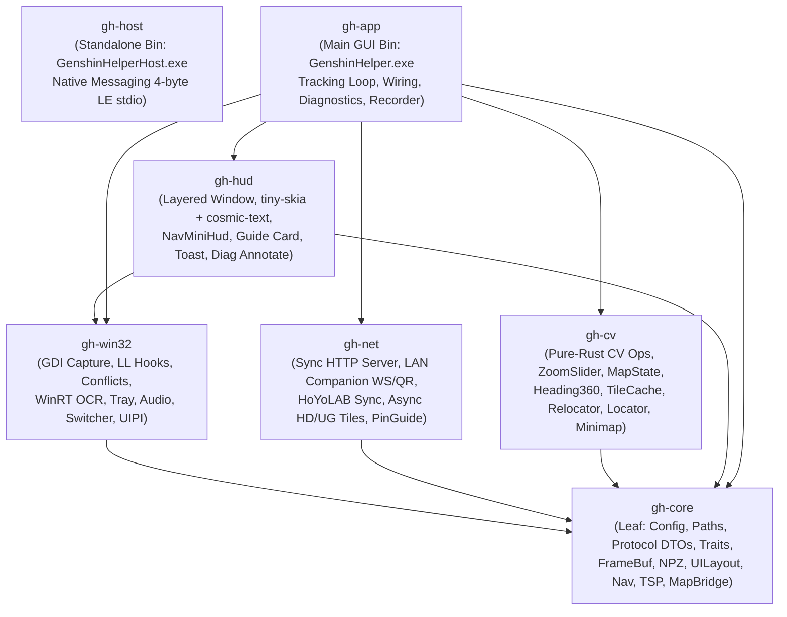

# Kế hoạch Migration Backend Python → Full Rust cho Genshin-Helper

> **Phạm vi**: Migrate toàn bộ backend Python (`src/` + `main.py`, 34 file / 29,425 LOC) sang Cargo Workspace thuần Rust tại `rust/`, **giữ nguyên 100% thư mục `extension/`** (Chrome/Edge MV3 Extension JS) không sửa đổi một byte nào.
>
> **Mục tiêu phát hành**: Bộ cài Inno Setup gọn nhẹ **~6–10 MB** (giảm từ 48.67 MB / 164.93 MB giải nén của PyInstaller), gồm đúng 2 file thực thi độc lập (`GenshinHelper.exe` + `GenshinHelperHost.exe`), **0 DLL ngoài** (không `opencv_world`, không Python runtime).

---

## 1. Kết quả Khảo sát Codebase & Môi trường

### 1.1 Tổng quan Codebase hiện tại
| Thành phần | Quy mô | Ghi chú khảo sát thực tế |
|---|---|---|
| Backend Python (`main.py` + 33 file `src/*.py`) | **34 file · 29,425 LOC** | `minimap_tracker.py` (3,587 L), `nav_hud.py` (2,819 L), `main.py` (2,729 L), `locator.py` (2,561 L), `map_bridge.py` (2,162 L), `nav_controller.py` (1,553 L), `lan_companion.py` (1,550 L), `server.py` (1,485 L). |
| OpenCV (`cv2.*`) | **93 ký hiệu trên 15 file** | Phổ biến nhất: `resize` (42), `cvtColor` (36), `Sobel` (20), `matchTemplate` (12, gồm cả **masked `TM_CCOEFF_NORMED`**), `findContours` (8), `warpAffine` (5), `SIFT_create` (4), `phaseCorrelate` (4), `estimateAffinePartial2D` (3), `FlannBasedMatcher` (2), `BFMatcher` (2), `Scharr` (2), `warpPolar` (2), `ORB_create` (1), `createCLAHE` (1), `Canny` (1), `connectedComponentsWithStats` (1), `convexHull`/`approxPolyDP`/`minEnclosingTriangle`. |
| Extension (`extension/`) | **16 file · ~615 KB** | Manifest V3, `version: "5.4.0"`, pinned RSA-2048 SPKI `"key"` → ID `nfkijdoblmphmdljfogooajhbldkeojh`. **Giữ nguyên 100%**. |
| Bộ kiểm thử (`tests/verify_*.py`) | **17 script · 9,057 LOC** | **100% import trực tiếp `src.*` / `main` trong tiến trình Python**; đọc offline fixture gitignored tại `scratch/`. |
| Static assets đóng gói release | **4 nhóm (~250 KB)** | Theo [GenshinHelper.spec](../installer/GenshinHelper.spec#L6-L11): `src/data/category_aliases.json` (14 KB), `src/locales/{vi,en}.json` (13 KB), `src/zoom_thumb_template.png` (1.5 KB), `assets/icons/*` (230 KB). |
| Runtime-hydrated assets (gitignored, bị cấm đóng gói theo `--strict-ip`) | **4 file (~11 MB)** | `multimap_v4.json`, `terrain_n2_v4.npz` (`u8`/`i64`), `cave_masks_v4.npz` (`u8`), `ui_anchors_v4.npz` (optional, `u8`/`f32`); cùng `%LOCALAPPDATA%\GenshinHelper\cache\{paimon_tpl.npz, teyvat_global_index_v*.npz}` (`u8`/`i32`/`f32`). Chỉ dùng đúng **4 dtype C-contiguous little-endian**: `u8`, `i32`, `i64`, `f32`. |

### 1.2 Toolchain & 6 Bẫy Kỹ thuật đã phát hiện sớm
1. **Toolchain Rust, `cc` & `rust-anything` cục bộ**:
   - `rustc 1.100.0` / `cargo 1.100.0` (`x86_64-pc-windows-msvc`, hỗ trợ `edition = "2024"`), kèm `cargo-nextest`, `clippy`, `rustfmt`.
   - `cc` trên `PATH`: `%USERPROFILE%\.cargo\bin\cc.exe` chuyển tiếp trực tiếp tới LLVM `clang 23.1.2` (`C:\Program Files\LLVM\bin\clang.exe`, target `x86_64-pc-windows-msvc`, đã thêm `C:\Program Files\LLVM\bin` vào User `PATH`).
   - `rust-anything 3.3.0` CLI đã cài toàn cục (`npm install -g rust-anything@3.3.0`) và bộ skill đã cài tại `.agents/skills/rust-anything/` & `.claude/skills/rust-anything/`.
   - Kết quả `rust-anything analyze . --whole-app --json` (`rust-anything/analyze@1`): xác nhận `38 source_files` (34 backend + 4 `scripts/*.py`), `17 test_files`, `0 parse_errors`, `0 blocked`, `0 keep`, `14 ready`, `21 caution`, `cv2` dùng ở đúng **15 file**, và 4 package trong `requirements.txt` (`bettercam`, `mss`, `pynput`, `requests`) có `used_by: 0`.
2. **Xác minh Linker Visual Studio 18 Insiders**: Đã xác minh thực tế qua `cargo nextest run` / `cargo test` — toolchain `x86_64-pc-windows-msvc` tự động link thành công cả proc-macro DLL lẫn binary `.exe` trên máy hiện tại (0 lỗi linker).
3. **Bẫy Release Audit (`scripts/audit_release.py --strict-ip`)**: [audit_release.py](../scripts/audit_release.py#L158-L170) quét **cả file `.exe`** để tìm đường dẫn workspace cục bộ (`<dev-root>`) (`HARDCODED_DEV_SOFT_PATH`) và `%USERPROFILE%`. Bản build `cargo build --release` mặc định nhúng đường dẫn registry Cargo (`%USERPROFILE%\.cargo\...`) và đường dẫn `.pdb` tuyệt đối vào `.exe`, sẽ **fail audit ngay lập tức** nếu thiếu:
   - `[profile.release]`: `strip = "symbols"`, `debug = false`, `panic = "abort"`, `lto = "thin"`, `codegen-units = 1`.
   - `rust/.cargo/config.toml` + `installer/build_release.ps1`: `-C link-arg=/PDBALTPATH:%_PDB%` (hoặc `/DEBUG:NONE`) và `--remap-path-prefix` cho `%USERPROFILE%\.cargo=/cargo` và repo root `=/src`.
4. **Hằng số `AGENTS.md` bị lệch so với code thực tế**: `AGENTS.md` ghi fallback offset là `-11.5`, nhưng [src/locator.py](../src/locator.py#L28-L38) thực tế dùng **`WORLD_ANCHOR_Y_OFFSET = -8.5`** (cộng `ICON_ANCHOR_OFFSET_PX_1440 = {2: (0.0, 3.5), 3: (0.0, 5.0), 154: (2.5, 0.0)}`, mặc định `(0.0, 5.0)`, và `ARROW_PIVOT_OFFSET_PX_1440 = 2.78`). Rust **bắt buộc port theo giá trị thật `-8.5`** (port `-11.5` sẽ lệch 3.0 world unit và làm fail `verify_alignment_v5.py`).
5. **Bẫy 7 phụ thuộc chéo nếu chia crate naive**: Kiểm tra AST toàn bộ 34 file Python phát hiện `asset_setup` → `hoyolab_sync`, `hd_assets` ↔ `tile_cache`, `locator` → `win_ocr`, `minimap_tracker` → `game_settings`, `server` → `hotkey_conflicts` + `diagnostics`, `diagnostics` → `capture` + `locator`, và các module Win32 có dùng `cv2`/`numpy`. Thiết kế DAG 7 crate bên dưới tách sạch mọi cạnh vòng bằng các trait trong `gh-core`.
6. **Bẫy giới hạn 2 MiB mặc định của Axum & Masked NCC**:
   - `/cross_map_export` nhận toàn bộ JSON `point_list` từ HoYoLAB (có thể vượt 2 MiB; [src/server.py](../src/server.py#L329) cho phép >256 KB với timeout 10s) → bắt buộc cấu hình `DefaultBodyLimit::max(32 * 1024 * 1024)`.
   - [src/minimap_tracker.py](../src/minimap_tracker.py#L1009-L1036) dùng `cv2.matchTemplate(..., TM_CCOEFF_NORMED, mask=...)` với mặt nạ nhị phân phi chữ nhật (elip Paimon + hình vành khuyên cắt nón) → FFT NCC thường không hỗ trợ mask; cần cài thuật toán **Padmanabhan (2012) masked FFT NCC (6 FFT)** kết hợp spatial SIMD cho template nhỏ.

---

## 2. Kiến trúc Cargo Workspace (`rust/`)

Workspace dùng **7 crate theo đồ thị có hướng không chu trình (DAG)**, phân tách rõ trách nhiệm và ranh giới thư mục để nhiều agent ở Giai đoạn 2–4 làm song song hoàn toàn không đụng file:



### 2.1 Cấu trúc thư mục & Ranh giới sở hữu Crate

```text
rust/
├── Cargo.toml                         # Virtual workspace (resolver="2", edition="2024", version="5.4.0")
├── .cargo/config.toml                 # MSVC /PDBALTPATH:%_PDB% & release link hygiene
└── crates/
    ├── gh-core/                       # Tầng 0 (Leaf) — ZERO Win32, ZERO HTTP, ZERO CV
    │   └── src/
    │       ├── lib.rs
    │       ├── config.rs              # AppConfig + config.json schema + APP_VERSION="5.4.0"
    │       ├── paths.rs               # Installed (%APPDATA%/%LOCALAPPDATA%) vs Dev path resolution
    │       ├── atomic_io.rs           # Temp + fsync + replace với Windows lock retry (winerr 5/32/33)
    │       ├── npz.rs                 # Pure-Rust .npy/.npz reader/writer trên `zip` (u8, i32, i64, f32)
    │       ├── frame.rs               # FrameBuf (Bgr8/Bgra8/Gray8/Rgba8) + zero-copy FrameView
    │       ├── i18n.rs                # VI/EN translator + include_str! locales + LocaleProvider trait
    │       ├── ui_layout.rs           # Unity CanvasScaler compute_ui_layout + HDR clipping + borderless args
    │       ├── multimap.rs            # MultimapDb, load_multimap_db, FloorOverlayMeta
    │       ├── assets.rs              # DataStatus, MD5 verify, staged promote+rollback, ensure_data_ready
    │       ├── nav_controller.rs      # NavPin, NavGuidance, NavigationController, priority tiers, sticky target
    │       ├── tsp_route.rs           # NN + 2-opt open-path TSP + waypoint teleport leg splitting
    │       ├── map_bridge.rs          # Category aliases (embedded), affine fit, 1-to-1 matcher, 4 formats
    │       ├── protocol.rs            # Toàn bộ HTTP/WS/Native-Messaging DTOs & BroadcastEvent enum
    │       └── traits.rs              # OcrProvider, TileProvider, UndergroundOverlaySource,
    │                                  # ConflictAdvisor, ServerCallbacks, DiagnosticService, LocaleProvider
    │
    ├── gh-win32/                      # Tầng 1 — Chỉ phụ thuộc gh-core + windows
    │   └── src/
    │       ├── lib.rs
    │       ├── capture.rs             # GDI SRCCOPY (cấm CAPTUREBLT) + 4-slot LRU DIBSection + WindowFinder
    │       ├── hotkey.rs              # Thuần WH_KEYBOARD_LL + WH_MOUSE_LL (cấm SendInput)
    │       ├── hotkey_conflicts.rs    # ConflictAdvisor + RegisterHotKey probe + NvidiaOverlayAdapter
    │       ├── game_settings.rs       # UIPI token check, HoYoPlay registry, borderless launch, WDA helper
    │       ├── win_ocr.rs             # In-process WinRT OcrEngine cài đặt OcrProvider (không spawn PowerShell)
    │       ├── tray.rs                # Shell_NotifyIconW + embedded .ico + TaskbarCreated recovery
    │       ├── audio.rs               # Tổng hợp PCM WAV 44.1kHz + PlaySoundW(SND_MEMORY)
    │       ├── switcher.rs            # WindowSwitcher Game <-> Browser + AllowSetForegroundWindow
    │       ├── locale.rs              # GetUserDefaultLocaleName / GetUserDefaultUILanguage
    │       └── runtime.rs             # timeBeginPeriod(1) + SingleInstanceMutex
    │
    ├── gh-net/                        # Tầng 1 — Chỉ phụ thuộc gh-core + axum/tokio/reqwest(rustls)
    │   └── src/
    │       ├── lib.rs
    │       ├── sync_server.rs         # 127.0.0.1:<port> HTTP + lossless /poll?since=<seq> + 32 MiB + takeover
    │       ├── lan_companion.rs       # Opt-in 0.0.0.0:<port> HTTP + WS + PIN rate-limit + QR SVG thuần Rust
    │       ├── hoyolab_sync.rs        # In-process HoYoLAB v4 dataset hydration runner
    │       ├── hd_assets.rs           # Async non-blocking HoyolabHdTileProvider + UndergroundOverlayProvider
    │       └── pin_guide.rs           # Bilingual (lang_tag, pin_id) PinGuideFetcher + HoYoLABLabelCatalog
    │
    ├── gh-cv/                         # Tầng 1 — Chỉ phụ thuộc gh-core + ndarray/rustfft/rayon/image
    │   └── src/
    │       ├── lib.rs
    │       ├── ops/                   # Primitives thuần Rust: color, resize, sobel/scharr, ncc (FFT + masked 6-FFT),
    │       │                          # phase_correlate, warp_polar, warp_affine, morph/contours/canny/clahe,
    │       │                          # sift (DoG RootSIFT), flann (4-tree KD-tree), orb, ransac_similarity
    │       ├── image_io.rs            # Unicode-safe PNG/WebP decode/encode qua atomic_io
    │       ├── zoom_slider.rs         # Diamond-masked NCC + linear scale law + embedded zoom_thumb_template.png
    │       ├── map_state.rs           # 3-Anchor Map (M) detector + 4-state FSM + RGB64 Bhattacharyya scene-cut
    │       ├── heading360.rs          # 3-tier camera cone + 3-tip arrow + PureOpenCVTracker
    │       ├── tile_cache.rs          # LruTerrainTileCache (72 tiles) + extract_underground_patch (Y-reflect)
    │       ├── global_relocator.rs    # Full-Teyvat RootSIFT KD-Tree (index_version=3) + async warmup
    │       ├── locator.rs             # Multi-map landmark graph + Sobel refinement (-8.5 Y) + cave masks
    │       └── minimap_tracker.rs     # HybridMinimapTracker (Gate, FSM, Paimon bootstrap, Follow-View -theta)
    │
    ├── gh-hud/                        # Tầng 2 — Chỉ phụ thuộc gh-core + gh-win32 + tiny-skia + cosmic-text
    │   └── src/
    │       ├── lib.rs
    │       ├── layered.rs             # Reusable WS_EX_LAYERED + DIBSection + 2s WDA refresh + 0x8015 affinity
    │       ├── fonts.rs               # Nạp trực tiếp Segoe UI / Segoe UI Semibold / Arial từ %WINDIR%\Fonts
    │       ├── nav_hud.rs             # NavHudRenderer (2-layer pre-bake <0.4ms) + SpringAngleSmoother + Guide Card
    │       ├── toast.rs               # HudToastOverlay (top-center single-monitor fade toasts)
    │       └── diag_annotate.rs       # Vẽ 04_cv_annotated.png hỗ trợ Unicode tiếng Việt đầy đủ
    │
    ├── gh-host/                       # Binary độc lập siêu nhỏ: GenshinHelperHost.exe (std + serde_json)
    │   └── src/main.rs                # Native Messaging 4-byte LE stdio + raw TcpStream HTTP + schtasks/launch
    │
    └── gh-app/                        # Binary GUI chính: GenshinHelper.exe (tích hợp toàn bộ crate)
        ├── build.rs                   # Nhúng app.ico + Windows version manifest (`winresource`)
        └── src/
            ├── main.rs                # CLI (--no-tray, --standby, --minimized, --record-minimap), startup hydration
            ├── tracking_loop.rs       # 60 Hz heading / 20 Hz full minimap + Map (M) FSM + HUD + LAN + HDR warn
            ├── callbacks.rs           # Concrete ServerCallbacks nối sync_server với mọi subsystem
            ├── config_watcher.rs      # 1s mtime hot-reload watcher + broadcast updates
            ├── diagnostics.rs         # DiagnosticManager (UID Gaussian blur, game+browser capture, 03_report.json)
            └── minimap_recorder.rs    # --record-minimap lossless developer benchmark recorder
```

### 2.2 Chiến lược tích hợp tùy chọn với `erkamyaman/rust-anything`
- Ở thời điểm Giai đoạn 1, `rust-anything` chưa được cài trong môi trường nên Giai đoạn 1 không phụ thuộc vào tool này.
- Khi bước sang Giai đoạn 2–3, nếu bạn cài `erkamyaman/rust-anything` (`cargo install rust-anything` + `rust-anything setup`), kiến trúc 7 crate trên **tương thích sẵn** với workflow `record` → `diff` (`cases.jsonl`) → `gate`:
  - Có thể thêm 1 crate bridge tạm không thuộc release build (ví dụ `rust/crates/gh-py-bridge` dùng PyO3/`maturin`, exclude khỏi `default-members`) chỉ để đối chiếu parity đầu vào/ra giữa Python và các module tính toán thuần trong `gh-core` / `gh-cv` (`nav_controller`, `tsp_route`, `map_bridge`, `heading360`, `zoom_slider`, `locator`, `minimap_tracker`).
  - Các tầng Win32/HUD/HTTP/Host (`gh-win32`, `gh-hud`, `gh-net`, `gh-host`, `gh-app`) port thẳng sang Rust và nghiệm thu bằng black-box contract tests + `cargo test`.
  - Ở Giai đoạn 4 (cutover sang binary thuần), gỡ bỏ `gh-py-bridge` hoàn toàn để giữ bộ cài sạch 2 file `.exe` không dính Python.

---

## 3. So sánh & Chốt 2 Quyết định Cốt lõi

### 3.1 Computer Vision: Pure-Rust vs `opencv` crate

| Tiêu chí | **Pure-Rust (`gh-cv::ops` + `ndarray` + `rustfft` + `rayon` + `image`)** *(Chốt)* | Crate `opencv` (C++ FFI) |
|---|---|---|
| Kích thước bộ cài & DLL | **~6–10 MB Setup EXE**, **0 DLL ngoài** (đạt mục tiêu 5–15 MB) | Phải đóng gói `opencv_world4xx.dll` (**60–90 MB giải nén**, ~30–45 MB Setup EXE) |
| Build toolchain | Thuần `cargo build --release`, không phụ thuộc ngoài | Cần C++ OpenCV SDK (vcpkg) + LLVM `libclang` + `bindgen` |
| Hiệu năng thực thi | Rust `-O3` + `rayon` + `rustfft` loại bỏ hoàn toàn overhead Python/NumPy (`heading360`, `map_state`, `locator`, `Sobel`) | AVX2/IPP có sẵn cho SIFT/ORB/FLANN |
| Khối lượng cài đặt | ~3–3.5k LOC trong `gh-cv::ops` (đa số op đơn giản; 3 op khó cần benchmark kỹ) | Không cần viết lại op CV |
| Rủi ro parity | **Trung bình–Cao** ở DoG RootSIFT + 4-tree KD-Tree FLANN, masked `TM_CCOEFF_NORMED`, ORB+RANSAC | Trùng khớp bit-by-bit với `cv2` Python |

**Chốt phương án: Pure-Rust** kèm **4 biện pháp kiểm soát rủi ro bắt buộc**:
1. Đóng gói feature extraction/matching sau trait nội bộ `FeatureMatcher` trong `gh-cv::ops` để dễ tinh chỉnh/thay thuật toán mà không sửa `locator.rs` hay `minimap_tracker.rs`.
2. Cài đặt **Padmanabhan (2012) masked FFT `TM_CCOEFF_NORMED`** (6 FFT trên `I, I², M, MT, MT²`) + nhánh spatial SIMD cho template nhỏ (thumb 31×31, Paimon half-res 34×38).
3. Nâng phiên bản cache global index lên **`teyvat_global_index_v3.npz` (`INDEX_VERSION = 3`)** để Rust tự build index sạch, không bao giờ đọc nhầm descriptor SIFT `v2` do OpenCV Python tạo ra.
4. **Cổng Gate 0 ở đầu Giai đoạn 3**: Benchmark trực tiếp RootSIFT + 4-tree KD-Tree + ORB + RANSAC thuần Rust trên fixture thực tế `scratch/minimap_rec/` và `scratch/yt_bench/` (so sánh recall %, sai số world unit, độ trễ median/p95 ms/frame với Python) **trước khi** port `minimap_tracker.rs`.

### 3.2 HUD Overlay: Win32 Layered Window (`windows` + `tiny-skia` + `cosmic-text`) vs Direct2D / DirectWrite

| Tiêu chí | **Win32 `UpdateLayeredWindow` + `tiny-skia` + `cosmic-text`** *(Chốt)* | Direct2D + DirectWrite (`ID2D1DCRenderTarget` / DComp) |
|---|---|---|
| Tương thích kiến trúc HUD hiện tại | Khớp **1:1** với `NavHudRenderer` pre-bake 2 lớp (`<0.4 ms/frame`) + top-down premultiplied BGRA DIB | Phải thiết kế lại quanh COM factory, brush, geometry, text layout |
| Ổn định với DX11 của game | **0 tranh chấp D3D/DXGI**, không bao giờ gặp lỗi `D2DERR_RECREATE_TARGET` khi Alt+Tab / đổi độ phân giải | DComp swapchain có rủi ro device-lost; CPU DC render target mất lợi thế GPU |
| Độ chính xác kênh Alpha | `tiny-skia` render sẵn premultiplied RGBA `SourceOver` (chỉ swizzle R↔B sang BGRA cho `AC_SRC_ALPHA`) | ClearType trên layered transparent DC dễ bị viền đen/lệch alpha nếu cấu hình sai |
| Chữ tiếng Việt & Unicode | `cosmic-text` (`rustybuzz` + `swash`) dựng dấu tiếng Việt chính xác | DirectWrite gốc Windows (dung lượng +0 MB) |
| Kiểm thử tự động headless | **100% deterministic `cargo test`** kiểm pixel alpha ≥ 240, cache hit, Guide Card layout không cần HWND | Phụ thuộc COM/HWND/GDI runtime |
| Ảnh hưởng dung lượng | +~1.5–2.5 MB (vẫn gọn trong mốc ~6–10 MB Setup EXE) | +~0 MB |
| Tái sử dụng thêm | Thay thế luôn `cv2.putText` khi vẽ `04_cv_annotated.png` (hiện chữ tiếng Việt có dấu sắc nét) | Phải viết luồng vẽ PNG riêng |

**Chốt phương án: Win32 Layered Window + `tiny-skia` + `cosmic-text`** kèm **1 tối ưu bắt buộc**:
- Nạp trực tiếp các file font mục tiêu (`Segoe UI`, `Segoe UI Semibold`, `Arial`) từ `%WINDIR%\Fonts` qua `fontdb::Database::load_font_file` (chỉ fallback quét toàn bộ hệ thống nếu thiếu), tránh độ trễ khởi động 50–150 ms.

---

## 4. Contract Bắt buộc Giữ Nguyên 100% với `extension/`

### 4.1 Định danh, Hằng số & Đường dẫn hệ thống
- `APP_VERSION = "5.4.0"` · `SCRIPT_VERSION = "v5.4.0"` · `HOST_VERSION = "5.4.0"`
- Pinned Extension ID: `nfkijdoblmphmdljfogooajhbldkeojh` (RSA-2048 SPKI `"key"` trong [extension/manifest.json](../extension/manifest.json#L5))
- Native Messaging Host: `com.genshinhelper.host` → `GenshinHelperHost.exe`, `allowed_origins: ["chrome-extension://nfkijdoblmphmdljfogooajhbldkeojh/"]` ([installer/native_host_manifest.json](../installer/native_host_manifest.json))
- Elevated Scheduled Task: `GenshinHelper_Elevated` (`"<app>\GenshinHelper.exe" --minimized`) ([installer/GenshinHelper.iss](../installer/GenshinHelper.iss#L62-L63))
- Single-Instance Mutex: `Local\GenshinHelper_SingleInstance_v4`
- Cổng mặc định: Sync Server `127.0.0.1:8765`, LAN Companion `0.0.0.0:8766` (opt-in, mặc định tắt)
- Subsystem Windows: `GenshinHelper.exe` dùng `#![windows_subsystem = "windows"]` (GUI không mở console); `GenshinHelperHost.exe` dùng console subsystem (bắt buộc cho stdio pipes của Chrome Native Messaging).

### 4.2 Sync Server HTTP Contract (`127.0.0.1:<ws_port>`, mặc định `8765`)
- **CORS & Private Network Access header trên MỌI phản hồi** (gồm `OPTIONS` → `204 No Content`, `Content-Length: 0`):
  ```http
  Access-Control-Allow-Origin: *
  Access-Control-Allow-Methods: GET, POST, OPTIONS
  Access-Control-Allow-Headers: *
  Access-Control-Allow-Private-Network: true
  Connection: close
  ```
- **Giới hạn thân yêu cầu**: tối thiểu **32 MiB** (không để mặc định 2 MiB của Axum vì `/cross_map_export` nhận toàn bộ `point_list` JSON từ HoYoLAB).
- **Tính tương thích HTTP Method**: Tất cả route đều chấp nhận cả `GET` và `POST` **ngoại trừ `/shutdown`** bắt buộc `POST` + peer loopback (`127.0.0.1` hoặc `::1`), trả `403 Forbidden` (`{"ok":false,"error":"Forbidden"}`) nếu sai (không trả `405`). Route không khớp trả `404 Not Found`.
- **Port takeover khi khởi động**: Khi bind gặp `WSAEADDRINUSE` (`10048`), gửi `POST http://127.0.0.1:<port>/shutdown` với `{}` (timeout 1.5s), chờ 450 ms, retry bind tối đa 5 lần với backoff 1s cho `TIME_WAIT` ([src/server.py](../src/server.py#L1363-L1391)).

| # | Route | Method | Request (JSON / Query) | Response (Status + JSON Schema) | Hiệu ứng / Broadcast |
|---|---|---|---|---|---|
| 1 | `/status` | `GET` | — | `200`: `{status:"connected", version:"5.4.0", script_version:"v5.4.0", queue_len, latest_seq, hotkey, display_name, hotkey_{sync,debug,switch,nav_mark,nav_undo,nav_guide,nav_next,nav_layout,nav_toggle}, display_name_{sync,debug,switch,nav_mark,nav_undo,nav_guide,nav_next,nav_layout,nav_toggle}, hotkey_suppress_conflicts, auto_sync_m, single_monitor_mode, monitor_count, engine_active, language, language_setting, minimap_tracking, nav_hud_enabled, nav_hud_position, nav_hud_custom_pos, nav_hud_edit_mode, nav_hud_capture_visible, nav_hud_guide_zoom_mode, audio_enabled, audio_volume, lan_companion_running, uipi_mismatch, uipi_status, last_sync}` | Cập nhật `_last_client_poll_ts` |
| 2 | `/poll` | `GET` | `?since=<i64>` (tùy chọn) | `200`: Event JSON kèm `_seq: u64`, hoặc `HEARTBEAT` sau 15s (hoặc ngay lập tức nếu `since < 0`), hoặc `{"type":"SHUTDOWN"}` | Cơ chế lossless đa tab (mục 4.3) |
| 3 | `/set_engine_state` | `POST` | `{active: bool}` | `200`: `{ok:true, engine_active:bool}` | Broadcast `ENGINE_STATE_UPDATED` |
| 4 | `/set_auto_sync` | `POST` | `{auto_sync_m: bool}` | `200`: `{ok:true, auto_sync_m:bool}` | Broadcast `AUTO_SYNC_UPDATED` |
| 5 | `/set_single_monitor` | `POST` | `{single_monitor_mode: bool}` | `200`: `{ok:true, single_monitor_mode:bool}` | Broadcast `SINGLE_MONITOR_UPDATED` |
| 6 | `/action_feedback` | `POST` | `{event_type, status, title?, detail?, seq?: int, action?: "mark"\|"unmark", pin_id?}` | `200`: `{ok:true, shown:bool, deduped:bool}` | Dedup 3.0s (`maxlen=24`); rollback mark cục bộ nếu `NAV_MARK` lỗi/`no_nearby`/`not_found`; hiện toast + âm thanh ở Single-Monitor |
| 7 | `/quick_switch` | `POST`/`GET` | `{}` | `200`: `{ok:true, target:"game"\|"browser"\|"no_browser"\|"none"}` | Đổi cửa sổ Game ↔ Browser + broadcast `FOCUS_MAP_TAB` |
| 8 | `/shutdown` | `POST` (loopback) | `{}` | `200`: `{ok:true, shutting_down:true}`; `403`: `{ok:false, error:"Forbidden"}` | Dừng tiến trình sạch sẽ |
| 9 | `/set_hotkey`, `/set_hotkeys` | `POST`/`GET` | Batch `{hotkey_<act>: str}` hoặc `{action, hotkey}` hoặc `{hotkey}` (fallback query string nếu body rỗng). 9 actions: `sync, debug, switch, nav_mark, nav_undo, nav_guide, nav_next, nav_layout, nav_toggle` | `200`: `{ok:true, results:{<act>:{ok, hotkey, display_name}}}` | Ghi `config.json`, broadcast `HOTKEY_UPDATED` cho từng action thành công |
| 10 | `/check_hotkey_conflicts` | `POST` | `{bindings?: map, hotkey?: str, action?: str, lang?: str, suppress_enabled?: bool}` | `200`: `{ok, actions, active_backups, nvidia_detected, ...}` (hoặc `{ok, single, active_backups, nvidia_detected}` nếu có `hotkey`) | Quét conflict + `RegisterHotKey` + NVIDIA GeForce/App (read-only) |
| 11 | `/remap_external_hotkey` | `POST` | `{app_id, shortcut_id, new_external_hotkey\|new_hotkey, claim_action?, claim_hotkey?, bindings?, lang?}` | `200`/`400`: `{ok, claim_updated?:{action, hotkey, display_name}, error?, ...}` | Sao lưu + sửa config NVIDIA; broadcast `HOTKEY_UPDATED` nếu có `claim_updated` |
| 12 | `/restore_external_hotkey` | `POST` | `{app_id, shortcut_id}` | `200`/`400`: `{ok, restored_display?, error?, ...}` | Khôi phục backup NVIDIA |
| 13 | `/report_state` | `POST` | `{center:[lat,lng], zoom, markersCount, activeAreaId, activeAreaName, layeredGroupId, layeredFloorId, scriptVersion, scriptBuild, runtimeMode}` | `200`: `{}` | Trộn vào `last_browser_state` |
| 14 | `/browser_state` | `GET` | — | `200`: JSON `last_browser_state` | Phục vụ diagnostics & kiểm thử |
| 15 | `/trigger_diagnostic` | `POST` | `{note?: str, source?: str}` | `200`: `{ok:true, bundle:{success, bundle_dir, folder_name, has_world_coords, reason, user_note, files}}` | Chụp game + browser, làm mờ UID, lưu `diag_YYYYMMDD_HHMMSS/` |
| 16 | `/save_diagnostic_note` | `POST` | `{folder_name: "diag_...", note: str}` | `200`: `{ok:true, folder_name, note_path, user_note}`; `400` nếu path traversal; `404` nếu không tồn tại | Ghi `05_user_note.txt` & cập nhật `03_report.json` |
| 17 | `/trigger_sync` | `POST`/`GET` | Các trường bổ sung ghép vào `{type:"SYNC_AND_MARK"}` | `200`: `{ok:true, broadcasted}` | Broadcast payload |
| 18 | `/set_language` | `POST` | `{language: "vi"\|"en"\|"auto"}` | `200`: `{ok:true, language, resolved}`; `400`: `{ok:false, error}` | Làm mới i18n, `HoYoLABLabelCatalog`, HUD, Guide Card, Tray; broadcast `LANGUAGE_UPDATED` |
| 19 | `/set_minimap_tracking` | `POST` | `{enabled? \| minimap_tracking?: bool}` | `200`: `{ok:true, enabled, minimap_tracking}` | Tạm dừng tracker & ẩn HUD khi false; broadcast `MINIMAP_TRACKING_UPDATED` |
| 20 | `/set_nav_hud` | `POST` | `{enabled?\|nav_hud_enabled?, position?\|nav_hud_position?, custom_pos?, edit_mode?: bool\|"toggle", capture_visible?\|nav_hud_capture_visible?, guide_zoom_mode?\|nav_hud_guide_zoom_mode?}` | `200`: `{ok:true, enabled, position, custom_pos?, edit_mode?, capture_visible?, nav_hud_capture_visible?, guide_zoom_mode?, nav_hud_guide_zoom_mode?}` | Cập nhật `NavMiniHud`, gửi `WM_APP_CAPTURE_AFFINITY` (`0x8015`); broadcast `NAV_HUD_UPDATED` |
| 21 | `/set_audio` | `POST` | `{audio_enabled?\|enabled?, audio_volume?\|volume?, test?: bool}` | `200`: `{ok:true, tested, audio_enabled, audio_volume}` | Phát chime thử nếu `test:true`; broadcast `AUDIO_UPDATED` |
| 22 | `/nearby_pins` | `POST` | `{pins:[...], map_id?: int=2, floor_id?, lat?, lng?, coverage_radius?}` | `200`: `{ok:true, count}` | Chuẩn hóa pin, cập nhật `NavigationController`, đẩy snapshot LAN |
| 23 | `/nav_command` | `POST` | `{action: "next"\|"prev"\|"skip"\|"undo"\|"refresh"\|"clear_route"\|"blacklist"\|"mark"\|"guide"\|"layout", pin_id?}` | `200`: `{ok, action, target?, summary?, guide_open?, edit_mode?}`; `400` nếu action sai | Điều khiển `NavigationController` / `NavMiniHud` |
| 24 | `/plan_tsp_route` | `POST` | `{pins:[...], start_pos?:[lat,lng], map_id?: int=2, teleport_penalty?: f64=180.0, waypoints?}` | `200`: `{ok:true, map_id, ordered_pins, legs, teleport_hints, pin_count, ...}`; `400` nếu lỗi | Chạy NN+2-opt TSP (`pins:[]` xóa route); broadcast `TSP_ROUTE_UPDATED` |
| 25 | `/lan_companion` | `POST`/`GET` | `{action?: "status"\|"start"\|"stop"\|"rotate"\|"toggle"}` | `200`: `{ok, running, is_running?, url, ws_url?, pin, token?, qr_svg, host?, port?, client_count?}`; `400` nếu action sai | Khởi động / tắt LAN HTTP+WS server |
| 26 | `/launch_borderless` | `POST` | `{dry_run?: bool, force?: bool, width?: int, height?: int, exe_path?: str}` | `200`: `{ok, launched, message, already_running?, exe_path?, cmd?, pid?, error?}` | Mở game với `-popupwindow -screen-fullscreen 0 -screen-width W -screen-height H` |
| 27 | `/cross_map_export` | `POST` | `{target_format\|format: "canonical"\|"kongying"\|"appsample"\|"genshinmap", map_id?: int=2, point_list?, marked_list?, pins?, target_pins?\|target_markers?, affine?, src_anchors?, dst_anchors?, use_identity_affine?, max_dist?: f64=15.0, include_ambiguous?: bool=true, existing_payload?}` | `200`: `{ok, format, payload, report, error?}`; `400` nếu format sai / lỗi | Chạy `gh-core::map_bridge` |

### 4.3 Cơ chế Lossless `/poll?since=<seq>` & Danh mục Event
- **Trạng thái nội bộ**:
  - `_event_seq: u64` đơn điệu tăng.
  - `_event_log: VecDeque<(u64, Value)>` (`maxlen = 128`) cho sự kiện bền vững (durable).
  - `_ephemeral_events: HashMap<String, (u64, Value)>` cho sự kiện tần suất cao (coalesce theo `type`, **không bao giờ đẩy sự kiện durable ra khỏi `_event_log`**).
  - `_event_queue: VecDeque<Value>` (`maxlen = 64`) tương thích ngược cho client `/poll` không kèm `?since=`.
- **Quy tắc xử lý `/poll`**:
  1. Nếu `since < 0` (ví dụ `?since=-1` khi Service Worker khởi động): **trả ngay lập tức** `{"type":"HEARTBEAT","script_version":"v5.4.0","_seq":<current_seq>}` (không chờ 15s).
  2. Nếu `since >= 0`: tìm sự kiện có `_seq` nhỏ nhất thỏa `_seq > since` trên cả `_event_log` và `_ephemeral_events`; nếu chưa có, chờ tối đa **15.0 giây** và thức dậy ngay khi có broadcast mới, hoặc hết giờ trả `HEARTBEAT` kèm `_seq` hiện tại.
  3. Khi server shutdown: đánh thức mọi waiter với `{"type":"SHUTDOWN"}`.
- **Side-effects bên trong `broadcast()`**:
  - Cập nhật `last_sync_info` khi `type ∈ {SYNC_POSITION_ONLY, SYNC_AND_MARK}` và `has_world_coords == true`.
  - Pre-seed bộ dedup `_feedback_seen` khi payload có `feedback_handled == true`.
- **Toàn bộ Event Types**:
  - *Durable*: `SYNC_POSITION_ONLY`, `SYNC_AND_MARK`, `ENGINE_STATE_UPDATED`, `AUTO_SYNC_UPDATED`, `SINGLE_MONITOR_UPDATED`, `HOTKEY_UPDATED`, `LANGUAGE_UPDATED`, `MINIMAP_TRACKING_UPDATED`, `NAV_HUD_UPDATED`, `AUDIO_UPDATED`, `TSP_ROUTE_UPDATED`, `DIAGNOSTIC_CAPTURED`, `FOCUS_MAP_TAB`, `NAV_MARK_PIN`, `LAN_COMPANION_UPDATED`, `UIPI_STATUS_UPDATED`.
  - *Ephemeral (`broadcast_ephemeral`)*: `MINIMAP_POSITION` (extension cũng hiểu bí danh `LIVE_POSITION`).
  - *Control*: `HEARTBEAT`, `SHUTDOWN`.

### 4.4 LAN Companion Contract (`0.0.0.0:<lan_companion_port>`, mặc định `8766`, opt-in)
- Routes: `GET /health` (`{ok:true, clients}`), `GET /` (trang nhập PIN + CSP nghiêm ngặt), `POST /auth/pin` (`{pin}` → `200 {ok:true, token, companion_path}` / `403` / `429` sau 5 lần sai trong 60s), `GET /companion` (token qua `?token=` hoặc header `Authorization` (`Bearer <token>`)), `GET /qr.svg` (token auth, sinh QR ISO 18004 V1–6 ECC-L offline thuần Rust), `GET /ws` & `GET /ws/<token>` (RFC 6455 WebSocket, đẩy ngay `latest_state`, coalesce 15 Hz, ngắt client nghẽn >256 KB).
- Header bảo mật trên mọi response: `Cache-Control: no-store`, `X-Content-Type-Options: nosniff`, `Referrer-Policy: no-referrer`; so sánh PIN/token constant-time (`401` thiếu token, `403` sai token).

### 4.5 Chrome Native Messaging Contract (`com.genshinhelper.host` → `GenshinHelperHost.exe`)
- **Framing**: Binary `stdin`/`stdout`, tiền tố độ dài **4 byte unsigned little-endian (`u32`, `1 <= len <= 1_048_576`)** + JSON UTF-8. **Tuyệt đối không in log hay BOM ra `stdout`**. Hỗ trợ cờ CLI `--port <u16>` (mặc định `8765`).
- **3 lệnh bắt buộc & schema trả về**:
  - `{"cmd":"ping"}` → `{ok:true, host_version:"5.4.0", server_running:bool, engine_active:bool, version?:str}`
  - `{"cmd":"start_server"}` → nếu server đang Standby thì gọi `POST /set_engine_state {active:true}` (`started:"woke_standby"`); nếu đang chạy sẵn thì trả `started:"already_active"`; ngược lại chạy `schtasks /run /tn GenshinHelper_Elevated` (`CREATE_NO_WINDOW`) rồi fallback spawn `GenshinHelper.exe --minimized` (`CREATE_NO_WINDOW | DETACHED_PROCESS`), poll `GET /status` mỗi 200 ms tối đa 12.0s → `{ok:true, host_version:"5.4.0", server_running:true, engine_active:true, started:"launched"}` (hoặc `{ok:false, host_version, server_running:false, error}`).
  - `{"cmd":"stop_server", "mode":"standby"|"shutdown"}` → `POST /set_engine_state {active:false}` hoặc `POST /shutdown {}` → `{ok:true, host_version:"5.4.0", server_running:bool, engine_active:bool, mode, acknowledged?:bool}`.

### 4.6 Schema `config.json`, Override `hoyolab_sync` & Quy tắc Đường dẫn (thay `sys._MEIPASS`)
- **26 khóa JSON cũ bắt buộc giữ tương thích ngược** ([src/config.py](../src/config.py#L40-L204)):
  `hotkey` & `hotkey_sync` (`"alt+f11"`), `hotkey_debug` (`"alt+f12"`), `hotkey_switch` (`"alt+q"`), `hotkey_nav_mark` (`"alt+k"`), `hotkey_nav_undo` (`"alt+shift+k"`), `hotkey_nav_guide` (`"alt+h"`), `hotkey_nav_next` (`"alt+n"`), `hotkey_nav_layout` (`"alt+shift+h"`), `hotkey_nav_toggle` (`"alt+x"`), `hotkey_suppress_conflicts` (`true`), `audio_enabled` (`true`), `audio_volume` (`50`, clamp `0..=100`), `chest_search_radius` (`30.0`), `ws_port` (`8765`), `auto_sync_m` (`true`), `single_monitor_mode` (`false`), `language` (`"auto"`, hợp lệ: `auto|vi|en`), `minimap_tracking` (`true`), `nav_hud_enabled` (`true`), `nav_hud_capture_visible` (`false`), `nav_hud_position` (`"under_minimap"`), `nav_hud_custom_pos` (`null` hoặc `[fx, fy]` trong `[0.0, 1.0]`, làm tròn 4 chữ số), `nav_hud_guide_zoom_mode` (`"cycle"`, hợp lệ: `cycle|compact|large`), `lan_companion_enabled` (`false`), `lan_companion_port` (`8766`, `1..=65535`), `instructions` (chuỗi tiếng Việt).
- **Nhánh mở rộng tùy chọn `hoyolab_sync` trong `config.json` (`#[serde(default)]`, tương thích ngược 100%)**:
  Cho phép người dùng/maintainer override các tham số dễ thay đổi của [src/hoyolab_sync.py](../src/hoyolab_sync.py#L23-L87) mà **không cần build lại binary**:
  ```json
  "hoyolab_sync": {
    "base_api": "https://sg-public-api.hoyolab.com/common/map_user/ys_obc",
    "tile_base": "https://act-webstatic.hoyoverse.com/map_manage/map",
    "rpc_map_version": "4.5",
    "user_agent": "Mozilla/5.0 (Windows NT 10.0; Win64; x64)",
    "default_map_ids": [2, 7, 9, 34, 36, 37, 40],
    "probe_id_range": [1, 80],
    "map_priorities": {"2": 1, "7": 4, "9": 3, "34": 5, "36": 6, "37": 7, "40": 2},
    "primary_landmark_labels": [2, 3, 154],
    "auto_check_on_startup": true,
    "auto_update_mode": "auto_download"
  }
  ```
  - **Tự kiểm tra `map_version` online vs local lúc mở app (`DatasetSyncRunner::check_online_map_versions`)**:
    1. Khi mở app, dùng ngay bộ dữ liệu local hiện có (0 ms chặn khởi động).
    2. Nếu `auto_check_on_startup == true` và `auto_update_mode != "off"`, spawn tác vụ nền gọi nhẹ `v1/map/info` lấy `detail_v2.map_version` online của các map đang quản lý + dò `probe_id_range` (khi Teyvat map 2 đổi version hoặc kiểm định kỳ), rồi so sánh với `maps[mid].detail_v2.map_version` trong `multimap_v4.json` local.
    3. Nếu có bản đồ/phiên bản mới:
       - `auto_update_mode = "auto_download"` *(mặc định)*: tải nền vào thư mục staging → verify JSON/NPZ/MD5 → atomic swap (rollback an toàn nếu rớt mạng) → nếu Map 2 đổi version thì vô hiệu hóa `teyvat_global_index_v3.npz` cũ để rebuild sạch → hot-reload `MapLocator`/`MinimapTracker` và thông báo qua Tray/Toast.
       - `auto_update_mode = "notify_only"`: chỉ hiển thị thông báo qua Tray/Toast để người dùng tự kích hoạt cập nhật.
- **Ghi file an toàn & Hot-Reload**: Ghi atomic UTF-8 JSON (`indent=4`, không escape Unicode) qua temp file + `fsync` + replace có retry 5×50 ms với lỗi lock Windows (`5/32/33`); watcher kiểm tra `mtime` mỗi 1.0s.
- **Phân giải đường dẫn (Installed vs Dev)**:
  - *Installed mode* (mặc định khi `.exe` không chạy từ thư mục dev/Cargo target gắn với repo có `extension/manifest.json`): `config.json` & `diagnostics/` tại `%APPDATA%\GenshinHelper`; dữ liệu hydrate tại `%LOCALAPPDATA%\GenshinHelper\data` (override qua `GENSHIN_HELPER_DATA_DIR`); HD tiles / UG overlays / Paimon / global index tại `%LOCALAPPDATA%\GenshinHelper\{tiles, ug_overlays, cache}`.
  - *Dev mode* (khi có `GENSHIN_HELPER_DEV_ROOT` hoặc chạy từ workspace dev): `config.json` tại root dự án, `diagnostics/` tại `scratch/diagnostics/`, ưu tiên đọc `src/data/` trước cache người dùng.
  - *Static bundled assets*: Nhúng trực tiếp 4 nhóm asset (~250 KB) vào binary bằng `include_bytes!`/`include_str!` (cho phép override trên đĩa ở Dev mode), loại bỏ hoàn toàn thư mục `_internal/` của PyInstaller.

---

## 5. Mapping 1-1 (`src/*.py` + `main.py` → Rust Crates) & Cổng Nghiệm thu 2 Lớp

### 5.1 Chiến lược Nghiệm thu 2 Lớp (Bắt buộc)
Do **100% trong số 17 file `tests/verify_*.py` import trực tiếp `src.*` / `main` in-process**, việc chạy `python tests/verify_*.py` không trực tiếp test mã Rust. Vì vậy cổng nghiệm thu chia 2 lớp bắt buộc:
- **Lớp A (Black-Box Contract & Release Gates trên binary Rust thật)**:
  1. `verify_i18n_and_ext_v5.py` chạy trực tiếp để bảo vệ `extension/` + tính nhất quán locale VI/EN.
  2. Black-box HTTP/WS/Native-Messaging harness (viết bằng Python hoặc Rust integration test) spawn `GenshinHelper.exe` & `GenshinHelperHost.exe` thật để test 27 route, `/poll?since=<seq>`, `/shutdown` 403, body >2 MiB, LAN Companion WS/PIN/QR, và Native Messaging stdio 4-byte LE.
  3. `.\.venv\Scripts\python.exe scripts/audit_release.py --strict-ip --artifact dist/GenshinHelper` + build Inno Setup `GenshinHelper-Setup-v5.4.0.exe`.
- **Lớp B (Rust `cargo test --workspace` + Golden Reference Oracle)**:
  - Port toàn bộ assertion và benchmark của 17 `tests/verify_*.py` sang `cargo test` dùng chung các fixture thực tế trong `scratch/`.
  - Giữ bộ `tests/verify_*.py` của Python làm **golden reference oracle** (kết hợp `rust-anything record/diff` nếu bạn kích hoạt ở Giai đoạn 2–3) để đối chiếu sai số tuyệt đối trên cùng bộ ảnh `scratch/`.

### 5.2 Bảng Mapping 1-1 Toàn bộ 34 File Python

| File Python (LOC) | Crate::Module Rust đích | Cổng `cargo test` (Lớp B) | Cổng Oracle / Black-Box (Lớp A) |
|---|---|---|---|
| `src/__init__.py` (2) | Workspace crate roots | `cargo check --workspace` | — |
| `src/config.py` (209) | `gh-core::config` | Roundtrip JSON, clamp volume/port, validate enum/custom_pos | Oracle: `verify_single_monitor.py`, `verify_perf_and_settings_v5.py`, `verify_hotkey_conflicts_and_capture.py` |
| `src/paths.py` (61) | `gh-core::paths` | Installed vs Dev detection, `GENSHIN_HELPER_DATA_DIR` override | Oracle: `verify_v45_release.py` |
| `src/image_io.py` (146) | `gh-core::atomic_io` + `gh-cv::image_io` | Retryable replace (winerr 5/32/33), Unicode path PNG/WebP I/O | Oracle: `verify_perf_and_settings_v5.py`, `verify_minimap_tracker_v5.py`, `verify_v53_production.py` |
| `src/i18n.py` (243) + `locales/*.json` | `gh-core::i18n` + `gh-win32::locale` | Embedded VI/EN parity + `{placeholder}` safe formatting | Black-box: `verify_i18n_and_ext_v5.py` |
| `src/asset_setup.py` (462) | `gh-core::assets` | MD5 manifest verify, staged promote & rollback, optional `ui_anchors_v4.npz` | Oracle + Black-box: `verify_public_readiness_v5.py`, `verify_v53_production.py` |
| `src/nav_controller.py` (1,553) | `gh-core::nav_controller` | Sticky target, proximity takeover, priority tiers, floor mismatch, 1s hold, undo/rollback | Oracle: `verify_nav_hud_v5.py`, `verify_nav_ux_v54.py`, `verify_hotkey_conflicts_and_capture.py` |
| `src/tsp_route.py` (491) | `gh-core::tsp_route` | NN + 2-opt open-path, waypoint teleport leg splitting (`multimap_v4.json`) | Oracle + Black-box `/plan_tsp_route`: `verify_tsp_and_lan_v5.py` |
| `src/map_bridge.py` (2,162) + `category_aliases.json` | `gh-core::map_bridge` | Embedded aliases, affine fit, 1-to-1 matcher, Kongying/Appsample/GenshinMap/Canonical | Oracle + Black-box `/cross_map_export`: `verify_map_bridge_v5.py` |
| `src/capture.py` (917) | `gh-win32::capture` | `SRCCOPY` only (cấm `CAPTUREBLT`), 4-slot LRU DIBSection, `_NON_COVERING_*`, 0 `SendInput` | Oracle: `verify_capture_no_flicker.py`, `verify_single_monitor.py`, `verify_perf_and_settings_v5.py`, `verify_hotkey_conflicts_and_capture.py`, `verify_nav_ux_v54.py` |
| `src/hotkey.py` (636) | `gh-win32::hotkey` | Thuần `WH_KEYBOARD_LL` + `WH_MOUSE_LL`, trigger-only suppression, 0 `SendInput`, live rebind | Oracle: `verify_single_monitor.py`, `verify_hotkey_conflicts_and_capture.py` |
| `src/hotkey_conflicts.py` (1,138) | `gh-win32::hotkey_conflicts` | `NvidiaOverlayAdapter` cô lập bằng temp path + `write_registry=false`, conflict scoring | Oracle + Black-box `/check_hotkey_conflicts`, `/remap_*`, `/restore_*`: `verify_hotkey_conflicts_and_capture.py` |
| `src/game_settings.py` (516) | `gh-core::ui_layout` + `gh-win32::game_settings` | CanvasScaler (16:9/21:9/16:10/4:3/32:9/gamepad), HDR clipping, UIPI, borderless args, WDA | Oracle + Black-box `/launch_borderless`: `verify_perf_and_settings_v5.py`, `verify_minimap_tracker_v5.py`, `verify_nav_hud_v5.py`, `verify_v53_production.py` |
| `src/win_ocr.py` (218) | `gh-win32::win_ocr` | In-process WinRT `OcrEngine` (`OcrProvider`) trên `scratch/ocr_query_*.png` | Oracle: `verify_v4_suite.py`, `verify_alignment_v5.py` |
| `src/tray.py` (408) | `gh-win32::tray` | Menu đa ngôn ngữ, tooltip cảnh báo UIPI, nạp `.ico` nhúng | Oracle: `verify_v45_release.py` |
| `src/single_monitor.py` (878) | `gh-win32::{audio, switcher}` + `gh-hud::toast` | Tổng hợp PCM WAV + volume clamp, `HudToastOverlay` alpha/lifecycle | Oracle: `verify_single_monitor.py` |
| `src/nav_hud.py` (2,819) | `gh-hud::{layered, fonts, nav_hud}` | Pre-bake 2 lớp, badge `<480 KB`, alpha ≥ 240, Guide Card zoom modes, `0x8015`, 2s WDA timer | Oracle: `verify_nav_hud_v5.py`, `verify_nav_ux_v54.py`, `verify_hotkey_conflicts_and_capture.py` |
| `src/server.py` (1,485) | `gh-net::sync_server` | Đủ 27 route, CORS/PNA, lossless `/poll?since=<seq>`, ephemeral coalesce, `/shutdown` 403, 32 MiB, port takeover | **Black-box HTTP suite** vào `GenshinHelper.exe` + Oracle: `verify_v4_suite.py`, `verify_v45_release.py`, `verify_single_monitor.py`, `verify_hotkey_conflicts_and_capture.py` |
| `src/lan_companion.py` (1,550) | `gh-net::lan_companion` | QR SVG ISO 18004 thuần Rust, PIN `429`, token `401`/`403`, WS 15 Hz coalesce | **Black-box HTTP+WS suite** + Oracle: `verify_tsp_and_lan_v5.py` |
| `src/hoyolab_sync.py` (399) | `gh-net::hoyolab_sync` | Mock HoYoLAB API → sinh `multimap_v4.json`, `cave_masks_v4.npz`, `terrain_n2_v4.npz` | Oracle: `verify_public_readiness_v5.py` |
| `src/hd_assets.py` (485) | `gh-core::multimap` + `gh-net::hd_assets` | Non-blocking `async_fetch=true`, disk cache, `.404` marker, 3-error 60s circuit breaker | Oracle: `verify_v53_production.py` |
| `src/pin_guide.py` (340) | `gh-net::pin_guide` | Cache/pending/inflight theo `(lang_tag, pin_id)`, strip HTML, `HoYoLABLabelCatalog` | Oracle: `verify_nav_ux_v54.py`, `verify_hotkey_conflicts_and_capture.py` |
| `src/zoom_slider.py` (199) + template | `gh-cv::zoom_slider` | `scratch/0zoom.png`, `scratch/100zoom.png` + linear scale law | Oracle: `verify_perf_and_settings_v5.py`, `verify_v4_suite.py` |
| `src/map_state.py` (471) | `gh-cv::map_state` | 3-Anchor FSM + strict dual-gate (`0.975`/`0.65`) + RGB64 Bhattacharyya trên `scratch/` | Oracle: `verify_map_state_v5.py`, `verify_v4_suite.py`, `verify_hotkey_conflicts_and_capture.py` |
| `src/heading360.py` (741) | `gh-cv::heading360` | 3-tier cone + 3-tip arrow (<2° error, <3 ms/frame) | Oracle: `verify_heading360_v5.py`, `verify_minimap_tracker_v5.py`, `verify_v53_production.py`, `verify_nav_ux_v54.py` |
| `src/tracker.py` (188) | Bỏ `CvAutoTrackBridge`; gộp `PureOpenCVTracker` vào `gh-cv::heading360` | Cyan arrow / yellow ping fullscreen detection | Oracle: `verify_heading360_v5.py` |
| `src/tile_cache.py` (625) | `gh-cv::tile_cache` | 72-tile O(1) LRU + `diag(1,-1,1)` underground Y-reflect patch | Oracle: `verify_minimap_tracker_v5.py`, `verify_v53_production.py`, `verify_nav_ux_v54.py` |
| `src/global_relocator.py` (394) | `gh-cv::global_relocator` | RootSIFT KD-Tree (`index_version=3`), async warmup, `is_ready` guard, recall trên `scratch/` | Oracle: `verify_v53_production.py` |
| `src/locator.py` (2,561) | `gh-cv::locator` | Landmark graph, Sobel refinement + `-8.5` Y offset (`2,9,34,36`), edge compass rejection, cave masks trên `scratch/Test-images/` & `scratch/diagnostics/` | Oracle: `verify_v4_suite.py`, `verify_alignment_v5.py`, `verify_nav_hud_v5.py` |
| `src/minimap_tracker.py` (3,587) | `gh-cv::minimap_tracker` | Gate, FSM, Paimon auto-bootstrap (`hd_sobel_fast` chờ bootstrap), Follow-View `-theta_mm_to_ref`, bounded phaseCorrelate trên `scratch/minimap_rec/` & `scratch/yt_bench/` | Oracle: `verify_minimap_tracker_v5.py`, `verify_v53_production.py`, `verify_nav_ux_v54.py` |
| `src/diagnostics.py` (403) | `gh-hud::diag_annotate` + `gh-app::diagnostics` | UID Gaussian blur redaction, `save_user_note` traversal guard, tạo bundle đầy đủ | Oracle + Black-box `/trigger_diagnostic`, `/save_diagnostic_note`: `verify_v4_suite.py`, `verify_perf_and_settings_v5.py` |
| `src/minimap_recorder.py` (142) | `gh-app::minimap_recorder` | Bounded async frame recorder | Oracle: `verify_nav_ux_v54.py` |
| `src/native_host.py` (267) | `gh-host` (`GenshinHelperHost.exe`) | 4-byte LE framing + `ping`/`start_server`/`stop_server` | **Black-box stdio pipe test** vào `GenshinHelperHost.exe` + `verify_v45_release.py` |
| `main.py` (2,729) | `gh-app` (`GenshinHelper.exe`) | Config hot-reload, mutex, tracking loop integration | **Black-box E2E** + `audit_release.py --strict-ip` + Inno Setup build |

### 5.3 Tối ưu Tốc độ Build/Test Rust & Tách Build Cache khỏi `rust/target/`
- **Không lưu cache build trong `rust/target/` (chỉ áp dụng riêng cho dự án này, sạch git)**:
  - File cục bộ gitignored `/.cargo/config.toml` (đã thêm vào `.gitignore`, không bị commit và không làm ảnh hưởng các dự án Rust khác trên máy) thiết lập:
    ```toml
    [build]
    target-dir = "C:\\CargoTarget\\Genshin-Helper"
    ```
  - Cargo tự động kế thừa `/.cargo/config.toml` cùng `rust/.cargo/config.toml` cho mọi lệnh `cargo` / `cargo-nextest` / `rust-anything` chạy trong repo → **0 byte build cache trong `rust/target/`**.
- **Tối ưu tốc độ chạy full test Rust (`rust/Cargo.toml` + `rust/.config/nextest.toml`)**:
  1. `[profile.dev.package."*"] opt-level = 2` và `[profile.test.package.gh-cv] opt-level = 2`: biên dịch mọi crate nặng (`image`, `rustfft`, `ndarray`, `tiny-skia`, `cosmic-text`, `zip`) và `gh-cv` ở mức tối ưu `-O2` ngay trong lúc test (nhanh gấp **10–30×** so với debug thuần mà vẫn giữ incremental compile nhanh cho các crate còn lại).
  2. `[profile.cv-bench]` (kế thừa `release` với `lto = false`, `codegen-units = 16`, `panic = "unwind"`): link nhanh như dev nhưng chạy benchmark CV ở tốc độ gần release.
  3. **Phân tầng 2 cấp với `cargo-nextest`** (chạy song song theo process, cách ly sạch file tạm/Win32):
     - **Fast Gate mặc định (< 5–10 giây)**: `cargo nextest run --manifest-path rust/Cargo.toml --workspace` — chạy toàn bộ unit test, protocol DTO, config, nav, TSP, map_bridge, mock HTTP/WS, HUD pixel và synthetic CV.
     - **Heavy CV Fixture Gate (`#[ignore]`)**: gắn `#[ignore]` cho các benchmark duyệt toàn bộ ảnh/video trong `scratch/Test-images/`, `scratch/diagnostics/`, `scratch/minimap_rec/`, `scratch/yt_bench/`; chạy tập trung khi xác minh CV bằng:
       ```powershell
       cargo nextest run --manifest-path rust/Cargo.toml --workspace --profile cv-heavy --cargo-profile cv-bench --run-ignored all
       ```

---

## 6. Project Invariants Bắt buộc Bảo toàn (từ `AGENTS.md` + Code thực tế)

1. **Read-Only Game Safety**: Tuyệt đối không đọc bộ nhớ tiến trình game, không inject DLL, **tuyệt đối không dùng `SendInput` vào cửa sổ game**. Hook `WH_KEYBOARD_LL` chỉ chặn (suppress) đúng phím trigger VK (không bao giờ chặn modifier), và chỉ khi cửa sổ game/HUD đang ở foreground. Mặc định `HOTKEY_NAV_MARK = "alt+k"`, `HOTKEY_NAV_UNDO = "alt+shift+k"` (tránh các phím menu luôn kích hoạt của Genshin).
2. **GDI Capture Không Nháy (`DECISION:` tại [src/capture.py](../src/capture.py#L787))**: Chỉ dùng `SRCCOPY` (`0x00CC0020`), **tuyệt đối không dùng `CAPTUREBLT`**, kèm pool 4-slot LRU top-down 32-bit `CreateDIBSection` theo từng thread.
3. **Capture-Excluded / Capture-Visible Mini-HUD**: Gọi `SetWindowDisplayAffinity(WDA_EXCLUDEFROMCAPTURE = 0x11)` và làm mới mỗi 2.0s; chuyển đổi sang `WDA_NONE` (`0x00`) qua `WM_APP_CAPTURE_AFFINITY` (`0x8015`); bảo toàn danh sách `_NON_COVERING_CLASSES` (10 lớp) và `_NON_COVERING_PROCESSES` (12 exe) trong `WindowFinder`.
4. **Lossless Multi-Tab `/poll?since=<seq>`**: Giữ nguyên `_event_seq` đơn điệu tăng + `_event_log` ring buffer (`maxlen=128`) + `_ephemeral_events` tách biệt + `HEARTBEAT` tức thời khi `since < 0`; không quay lại kiểu pop phá hủy một consumer.
5. **Zoom Slider Dual-Gate**: `detect_slider()` lọc ở `ccorr >= 0.88`; `map_state` strict / drawer-occluded hysteresis bắt buộc `match_score >= 0.975 && ccoeff >= 0.65` (và `0.82` cho Gear/Close-X khi có `ui_anchors_v4.npz`) để chặn báo giả mở bản đồ.
6. **World Alignment & Edge Compass Rejection**: Tinh chỉnh Sobel trên `terrain_data` + fallback **`-8.5` Y offset** trên map `2, 9, 34, 36` + offset icon màn hình `{2:(0,3.5), 3:(0,5.0), 154:(2.5,0)}` + `2.78 px` arrow pivot offset @1440p; loại bỏ huy hiệu la bàn ngoài mép màn hình trong `detect_player_arrow`.
7. **V5.3 Minimap Engine**: `HoyolabHdTileProvider`/`UndergroundOverlayProvider` non-blocking (`async_fetch=true`); kiểm tra `TeyvatGlobalRelocator.is_ready` trước khi tăng `_global_query_count`; giữ nguyên dấu Follow-View `theta_map_deg = wrap(-theta_mm_to_ref)`; auto-bootstrap Paimon sạch IP tại `%LOCALAPPDATA%\GenshinHelper\cache\paimon_tpl.npz` (bỏ qua `hd_sobel_fast` cho đến khi bootstrap xong).
8. **Bilingual Caching & IP/Release Hygiene**: Cache/pending/inflight của `PinGuideFetcher` đánh khóa theo `(lang_tag, pin_id)` + nối `HoYoLABLabelCatalog`; hydrate dữ liệu in-process ở lần chạy đầu (`ui_anchors_v4.npz` tùy chọn); không để lọt `src/data/*.npz`, `paimon_master.png`, hay đường dẫn dev (`USERPROFILE`, đường dẫn workspace cục bộ (`<dev-root>`)) vào git hoặc binary trong `dist/GenshinHelper` (bắt buộc pass `audit_release.py --strict-ip`).
9. **Bảo toàn Extension & Fixtures**: Không sửa đổi bất kỳ file nào trong `extension/`; bảo toàn nguyên vẹn mọi fixture offline trong `scratch/`; luôn cô lập test `NvidiaOverlayAdapter` bằng temp path + `write_registry = false`.

---

## 7. Lộ trình Thực thi Tăng dần (Giai đoạn 1–4)

| Giai đoạn | Phạm vi & Nhánh song song | Cổng hoàn thành (Exit Gate) |
|---|---|---|
| **Giai đoạn 1 (Hoàn tất)** | Khảo sát codebase, cài skill & CLI `rust-anything 3.3.0` + `cc` trên `PATH`, lập tài liệu này, dựng khung Workspace 7 crate tại `rust/` + tối ưu cache `CARGO_TARGET_DIR`. | `cargo nextest run --workspace`, `cargo clippy -- -D warnings`, `audit_release.py --strict-ip` đều **PASS**; 0 byte build cache trong `rust/target/`. |
| **Giai đoạn 2 (4 luồng song song)** | **Track A**: `gh-core` full logic · **Track B**: `gh-win32` · **Track C**: `gh-net` + `gh-host` · **Track D**: `gh-hud`. | Mọi crate pass `cargo nextest run` độc lập; black-box test cho `gh-host` (stdio) và `gh-net` (27 HTTP routes + LAN WS + `hoyolab_sync` version check) pass 100%. |
| **Giai đoạn 3 (CV + Gate 0)** | **Gate 0**: Benchmark `gh-cv::ops` (RootSIFT, 4-tree KD-Tree, masked 6-FFT NCC, ORB+RANSAC) trên `scratch/minimap_rec/` & `scratch/yt_bench/`. **Track E1**: `zoom_slider`, `map_state`, `heading360`, `locator`. **Track E2**: `tile_cache`, `global_relocator`, `minimap_tracker`. | Toàn bộ fixture `scratch/` đạt parity ngang/vượt Python oracle (`verify_v4_suite`, `verify_alignment_v5`, `verify_heading360_v5`, `verify_map_state_v5`, `verify_minimap_tracker_v5`, `verify_v53_production`). |
| **Giai đoạn 4 (Tích hợp & Cutover)** | Wiring `gh-app`, black-box E2E với `extension/` thật, cập nhật `installer/build_release.ps1`, `scripts/{audit_release.py, collect_licenses.py, register_dev_native_host.ps1}` (hỗ trợ Rust + thu thập license crate), đóng gói Inno Setup, dọn Python cũ (Mục 7.1) và đồng bộ toàn bộ tài liệu (Mục 7.2). | `verify_i18n_and_ext_v5.py` pass · Black-box E2E pass · `audit_release.py --strict-ip --artifact dist/GenshinHelper` pass · Setup EXE đạt **~6–10 MB**, 0 DLL ngoài · Tài liệu & chỉ mục GitNexus đã đồng bộ. |

### 7.1 Xử lý Code Python cũ sau khi Migrate hoàn tất (Cutover & Retirement)
1. **Trong suốt Giai đoạn 2–4 (trước cutover)**: Giữ nguyên 100% `main.py`, `src/*.py`, `tests/verify_*.py`, `requirements.txt` song song với `rust/` để làm **golden reference oracle** (so sánh từng module/fixture và chạy `rust-anything record/diff`) và làm đường lùi tức thời.
2. **Đóng băng lịch sử trước khi dọn**: Khi bản Rust vượt qua toàn bộ cổng Giai đoạn 4 và chạy ổn định thực chiến trong game, gắn git tag `v5.4.0-python-final` (hoặc giữ nhánh `archive/python-v5.4`) để có thể tra cứu/checkout lại bất cứ lúc nào.
3. **Dọn sạch backend Python cũ**:
   - **Di dời 4 static asset** đang nằm trong `src/` (`src/data/category_aliases.json`, `src/locales/{vi,en}.json`, `src/zoom_thumb_template.png`) sang `assets/` (hoặc `rust/assets/`) để Rust `include_bytes!`/`include_str!` trực tiếp, cắt hoàn toàn phụ thuộc vào `src/`.
   - **Xóa**: `main.py`, toàn bộ `src/*.py` (34 file), `requirements.txt`, `installer/GenshinHelper.spec`, các `tests/verify_*.py` chỉ import `src.*` in-process, và `scripts/{sync_hoyolab_data.py, build_multimap_db.py}` (thay bằng CLI `GenshinHelper.exe --sync-data`).
4. **Thành phần giữ lại lâu dài**:
   - **Giữ nguyên 100%**: `extension/`, `installer/{GenshinHelper.iss, native_host_manifest.json, install_extension.html}`, `assets/icons/`, `scratch/` (offline fixtures).
   - **Giữ lại làm dev/CI tooling** (không đóng gói vào Setup EXE): `scripts/audit_release.py`, `scripts/collect_licenses.py`, `tests/verify_i18n_and_ext_v5.py`, và bộ black-box contract test bắn thẳng vào `GenshinHelper.exe` / `GenshinHelperHost.exe`.

### 7.2 Cập nhật Tài liệu Liên quan (Post-Cutover Documentation Sync)
Sau khi hoàn tất Giai đoạn 4 và chốt cutover sang binary Rust, bắt buộc rà soát và đồng bộ 4 nhóm tài liệu sau trước khi đóng kế hoạch:
1. **Tài liệu người dùng (Public Docs)**:
   - [README.md](../README.md) & [README.vi.md](../README.vi.md): cập nhật kiến trúc Pure Rust (~6–10 MB, 0 DLL ngoài), hướng dẫn build từ nguồn (`cargo build --release`, `cargo nextest`), hướng dẫn cấu hình nhánh `hoyolab_sync` trong `config.json` & tự động kiểm tra/tải `map_version`, và danh sách cờ CLI (`--sync-data`, `--no-tray`, `--standby`, `--minimized`, `--record-minimap`).
   - [PRODUCT.md](../PRODUCT.md): cập nhật thông số kiến trúc, kích thước bộ cài, mức dùng RAM/CPU & độ trễ thực đo của bản Rust.
   - [SECURITY.md](../SECURITY.md): cập nhật mô hình an toàn read-only cho binary Rust (`WH_KEYBOARD_LL`, `SRCCOPY`, cơ chế `audit_release.py` quét `.exe` & remap đường dẫn Cargo).
2. **Tài liệu phát triển & GitHub Templates**:
   - [CONTRIBUTING.md](../CONTRIBUTING.md): hướng dẫn cài đặt Rust toolchain, `cargo-nextest`, cấu trúc 7 crate `rust/crates/gh-*`, cách tách build cache qua `/.cargo/config.toml` cục bộ (gitignored), và lệnh chạy Fast Gate vs `cv-heavy`.
   - [.github/PULL_REQUEST_TEMPLATE.md](../.github/PULL_REQUEST_TEMPLATE.md) & [.github/ISSUE_TEMPLATE/bug_report.md](../.github/ISSUE_TEMPLATE/bug_report.md): chuyển checklist kiểm thử sang `cargo nextest`, `cargo clippy -- -D warnings`, `verify_i18n_and_ext_v5.py`, `audit_release.py --strict-ip`, và cập nhật mẫu báo lỗi theo phiên bản binary Rust.
3. **Bản quyền & Ghi công thư viện (License Compliance)**:
   - [THIRD_PARTY_NOTICES.md](../THIRD_PARTY_NOTICES.md) và đầu ra `dist/GenshinHelper/THIRD_PARTY_LICENSES.md` (do `scripts/collect_licenses.py` trích từ `cargo metadata`): thay thế danh sách thư viện Python/OpenCV/PyInstaller bằng danh sách **Rust crates** thực dùng (`windows`, `axum`, `tokio`, `tiny-skia`, `cosmic-text`, `image`, `ndarray`, `rustfft`, `reqwest`, `serde`...).
4. **Agent Rules & Chỉ mục Code Intelligence**:
   - [AGENTS.md](../AGENTS.md) & [CLAUDE.md](../CLAUDE.md): cập nhật `Project Invariants` từ đường dẫn `src/*.py` + `tests/verify_*.py` sang `rust/crates/gh-*` + `cargo nextest` (giữ nguyên invariant của `extension/` và `scratch/`).
   - Chạy lại `npx gitnexus analyze` sau khi dọn code Python cũ để đồng bộ đồ thị tri thức của codebase.
   - *(Giữ nguyên không sửa)*: [extension/README.md](../extension/README.md) (thuộc `extension/` bất biến), [DESIGN.md](../DESIGN.md) (mô tả UI popup extension), và [LICENSE](../LICENSE).

---

## 8. Quy tắc Vận hành `/teamwork` Swarm & Bảng Pin Crate Chuẩn

Để nhiều agent chạy song song ở Giai đoạn 2–4 mà **0 xung đột file, 0 tranh chấp `Cargo.lock`, 0 kẹt `.cargo-lock` trên ổ `D:`**, toàn bộ phiên `/teamwork` tuân theo 5 quy tắc cứng sau:

### 8.1 Chuẩn bị & Chia Đợt có Checkpoint (3 Đợt)
- **Điều kiện tiên quyết**: Phải `git commit` sạch mốc trước đó để mọi worktree `workspace: "share"` nhìn thấy đầy đủ `rust/`, `rust/MAP.md` và `docs/rust-migration-plan.md`.
- **Đợt 1 (Giai đoạn 2)**:
  - **Bước 2A (khóa API chung trước)**: 1 worker hoàn thiện `gh-core` (đủ chữ ký public + unit tests cho `atomic_io`, `npz`, `i18n`, `multimap`, `assets`, `nav_controller`, `tsp_route`, `map_bridge`, `paths`) và Coordinator merge vào workspace chính + pre-add danh sách crate chuẩn của Giai đoạn 2 vào `rust/Cargo.toml` (1 lần duy nhất).
  - **Bước 2B (3 nhánh song song không đụng file)**:
    - Worker `win32` → chỉ sở hữu `rust/crates/gh-win32/**`.
    - Worker `net-host` → chỉ sở hữu `rust/crates/gh-net/**` và `rust/crates/gh-host/**`.
    - Worker `hud` → chỉ sở hữu `rust/crates/gh-hud/**`.
  - **Checkpoint 1**: Merge lần lượt từng nhánh → chạy `cargo nextest run --manifest-path rust/Cargo.toml --workspace`, `cargo clippy -- -D warnings`, black-box test cho `gh-host` (stdio) và `gh-net` (27 HTTP routes + LAN WS) → cập nhật `rust/MAP.md` & commit.
- **Đợt 2 (Giai đoạn 3 — CV)**:
  - **Gate 0 trước**: 1 worker dựng `gh-cv::ops` (Sobel/Scharr, FFT & masked 6-FFT NCC, phaseCorrelate, warpPolar/warpAffine, contours/Canny/CLAHE, DoG RootSIFT, 4-tree KD-Tree, ORB, RANSAC) và benchmark trên `scratch/minimap_rec/` + `scratch/yt_bench/` bằng `--profile cv-heavy --cargo-profile cv-bench` → dừng kiểm tra recall %, sai số world unit, độ trễ median/p95 so với Python oracle.
  - **Bước 3B (2 nhánh song song)**:
    - Worker `cv-map` → `zoom_slider.rs`, `map_state.rs`, `heading360.rs`, `locator.rs`, `image_io.rs`.
    - Worker `cv-minimap` → `tile_cache.rs`, `global_relocator.rs`, `minimap_tracker.rs`.
  - **Checkpoint 2**: Chạy full `cv-heavy` trên toàn bộ `scratch/` → cập nhật `rust/MAP.md` & commit.
- **Đợt 3 (Giai đoạn 4 — Tích hợp, Release & Cutover)**:
  - Wiring `gh-app`, black-box E2E với `extension/` thật, cập nhật `installer/build_release.ps1` + `scripts/{audit_release.py, collect_licenses.py, register_dev_native_host.ps1}`, đóng gói Inno Setup (~6–10 MB, 0 DLL ngoài), pass `audit_release.py --strict-ip --artifact dist/GenshinHelper`.
  - Sau khi user test thực chiến trong game & xác nhận cutover: gắn tag `v5.4.0-python-final`, thực hiện dọn Python cũ (Mục 7.1) và đồng bộ tài liệu (Mục 7.2).

### 8.2 Quy tắc Sở hữu File & Cô lập Build Cache cho Worker Song song
1. **Quyền sửa `rust/Cargo.toml` gốc**: Chỉ **Coordinator** chỉnh `[workspace.dependencies]` trong `rust/Cargo.toml` và cập nhật `rust/MAP.md` sau khi merge. Worker chỉ sửa file trong phạm vi `rust/crates/<crate-được-giao>/**` (không đụng `extension/`, `src/`, `scratch/`, hay crate của worker khác).
2. **Tránh kẹt `.cargo-lock` khi chạy song song**: Mỗi worker chạy trong worktree `workspace: "share"` đặt biến môi trường riêng cho phiên build/test của mình:
   ```powershell
   $env:CARGO_TARGET_DIR = "C:\CargoTarget\Genshin-Helper-<worker>"
   ```
   Nhờ vậy 0 byte ghi xuống `rust/target/` và không bao giờ phải xếp hàng chờ khóa build chung. Sau khi merge xong đợt, xóa các thư mục tạm `Genshin-Helper-<worker>` và chạy cổng chung trên `CARGO_TARGET_DIR` mặc định.
3. **Bắt buộc tôn trọng mọi Invariant ở Mục 6** và chạy đủ 3 lệnh kiểm trước khi báo hoàn tất:
   - `cargo nextest run --manifest-path rust/Cargo.toml -p <crate>`
   - `cargo clippy --manifest-path rust/Cargo.toml -p <crate> --all-targets -- -D warnings`
   - `.\.venv\Scripts\python.exe scripts/audit_release.py --dir rust/crates/<crate> --strict-ip`

### 8.3 Bảng Pin Crate Chuẩn cho Toàn bộ Workspace (Giấy phép MIT/Apache-2.0/BSD/Zlib, 0 GPL)

| Crate đích | Phụ thuộc chuẩn (ưu tiên bản đã có sẵn trong Cargo cache cục bộ) | Ghi chú cấu hình |
|---|---|---|
| `gh-core` | `serde = "1"`, `serde_json = "1"`, `thiserror = "2"`, `zip = "9"` (`9.2.1`), `md-5 = "0.10"` (`0.10.6`) | `zip`: `default-features = false, features = ["deflate"]` (tránh kéo C bzip2/zstd) |
| `gh-win32` | `gh-core`, `windows = "0.62"` (`0.62.2`) | Chỉ bật đúng feature Win32/WinRT cần dùng (GDI, Input, UI, Foundation, Storage, Media_Ocr, Graphics_Imaging, Shell, Security, System_Threading) |
| `gh-net` | `gh-core`, `tokio = "1"` (`1.54.1`), `axum = "0.8"` (`0.8.9`, feature `ws`), `tower-http = "0.6"` (`0.6.11`, `cors`, `limit`), `reqwest = "0.12"` (`0.12.28`), `subtle = "2.6"` (`2.6.1`), `rand = "0.9"` (`0.9.5`), `image = "0.25"` (`0.25.10`) | `reqwest`: `default-features = false, features = ["rustls-tls", "json", "blocking"]` (0 OpenSSL DLL); `image`: `default-features = false, features = ["png", "webp", "jpeg"]` |
| `gh-hud` | `gh-core`, `gh-win32`, `tiny-skia = "0.12"` (`0.12.0`), `cosmic-text = "0.12"` (hoặc bản mới nhất tương thích MIT/Apache-2.0), `image = "0.25"` | Nạp trực tiếp font `Segoe UI`/`Arial` từ `%WINDIR%\Fonts` |
| `gh-cv` | `gh-core`, `image = "0.25"`, `rayon = "1.12"` (`1.12.0`), `ndarray = "0.16"`, `rustfft = "6"` | Không phụ thuộc `windows` hay `reqwest`; mọi op nặng đi qua `gh-cv::ops` |
| `gh-host` | `gh-core`, `serde = "1"`, `serde_json = "1"` | Tuyệt đối không kéo `tokio`/`reqwest`/`windows` — giữ `GenshinHelperHost.exe` < 1 MB |
| `gh-app` | `gh-core`, `gh-win32`, `gh-net`, `gh-cv`, `gh-hud`, `clap = "4.6"` (`4.6.7`, `derive`), `tracing = "0.1"` (`0.1.44`), `tracing-subscriber = "0.3"` (`0.3.23`), build-dep `winresource = "0.1"` | Release GUI `#![cfg_attr(not(debug_assertions), windows_subsystem = "windows")]` |
